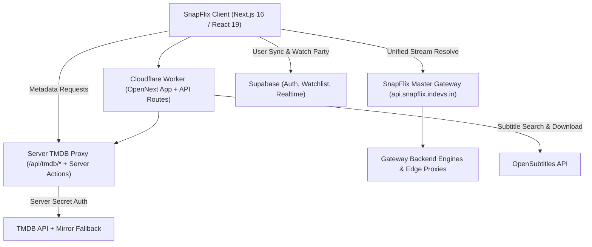

<h1 align="center">
  
  <br />
  SnapFlix
</h1>

<p align="center">
  <strong>Next-Gen Cinema Web Platform powered by SnapFlix Master Gateway & Audio-First Adaptive Streaming.</strong>
</p>

<p align="center">
  <a href="https://snapflix.indevs.in">
    
  </a>
  <a href="https://nextjs.org">
    
  </a>
  <a href="https://www.typescriptlang.org">
    
  </a>
  <a href="https://tailwindcss.com">
    
  </a>
  <a href="https://supabase.com">
    
  </a>
</p>

---

## 🌟 Overview

**SnapFlix** is a private, high-contrast cinema streaming platform built with **Next.js 16 (App Router / Turbopack)** and deployed on **Cloudflare Workers (OpenNext)**.

All third-party client providers and fragmented scraper fallbacks have been retired. Stream discovery, language prioritization, and multi-engine orchestration run exclusively through our own **SnapFlix Master Gateway** (`https://api.snapflix.indevs.in`), while TMDB metadata is protected behind a dedicated server-side proxy so private tokens never reach the browser.

---

## ✨ Key Features

### 🎬 Cinema Discovery & Protected Metadata
- **Netflix-Inspired UI**: Hero billboard, trending rows, top-10 highlights, collections, and instant search across movies, TV series, people, and genres.
- **Zero-Leak Server TMDB Proxy**: Every client-side TMDB request routes transparently through `/api/tmdb/[...path]` and Next.js Server Actions, attaching server-only `TMDB_ACCESS_TOKEN` credentials with automatic mirror fallback (`db.wecollege.net`) and zero `401` errors or bundled secrets.
- **Personal Watchlist & Resume Sync**: Cloud-synced watchlist, bookmarks, and playback progress powered by Supabase.

### ⚡ SnapFlix Master Gateway (`api.snapflix.indevs.in`)
- **Single-Endpoint Gateway Architecture**: The web app connects exclusively to `NEXT_PUBLIC_GATEWAY_URL` (`/api/v1/resolve` and `/api/provider/resolve`), removing all legacy fallback domains from frontend code.
- **Multi-Engine Orchestration & Caching**: The Master Gateway queries backend engines concurrently in a single request, caches resolved results, and returns normalized stream arrays plus per-engine metadata (`hasHindi`, `primaryAudio`, `engines`, `streams`).
- **Automatic Background Failover**: If an active stream stalls or returns a network error, the player automatically switches to the next healthy engine stream matching the user's active audio language with no manual server hunting.

### 🎥 Audio-First Web Player (`NativeWebPlayer`)
- **Hindi-First Audio Anchor**: Prioritizes Hindi audio by default when available and accurately detects original/other tracks (English, Korean, Japanese, Tamil, Telugu, etc.) without mislabeling non-Hindi HLS streams.
- **Unique Deduplicated Quality Selector**: Aggregates unique resolutions (`Auto`, `4K`, `1440p`, `1080p`, `720p`, `480p` / `360p`) across all Gateway engines strictly filtered for the active audio language, keeping audio locked when switching quality.
- **Clean Player Controls**: Desktop Quality popover and mobile bottom sheets (`Quality | Audio | Subs`) with internal/external HLS audio & resolution switching and no server-selection clutter.
- **Universal Subtitles System**: Background OpenSubtitles lookup, internal HLS tracks, custom `.srt`/`.vtt` uploads, language flags, and styling customization.
- **Watch Party (Supabase Realtime)**: Synchronized group playback and live chat reactions.

---

## 🛠️ Architecture



---

## 💻 Tech Stack

| Domain | Technologies |
| :--- | :--- |
| **Framework** | [Next.js 16.4.3 (App Router)](https://nextjs.org/) & React 19 |
| **Language** | [TypeScript 5.x](https://www.typescriptlang.org/) |
| **Styling** | [Tailwind CSS 4](https://tailwindcss.com/) & HeroUI / React Icons |
| **Player & Video** | [Hls.js](https://github.com/video-dev/hls.js/) + Native HTML5 Video |
| **Edge Hosting** | [Cloudflare Workers](https://workers.cloudflare.com/) via `@opennextjs/cloudflare` |
| **Streaming API** | SnapFlix Master Gateway (`https://api.snapflix.indevs.in`) |
| **Database & Realtime** | [Supabase](https://supabase.com/) (PostgreSQL, Auth, Realtime Channels) |
| **Metadata & Subtitles** | [The Movie Database (TMDB)](https://www.themoviedb.org/) & OpenSubtitles |

---

## 🚀 Getting Started

### 1. Clone & Install
```bash
git clone https://github.com/SnapFlix-App/SnapFlix.git
cd SnapFlix/SnapFlix-Web
npm install
```

### 2. Environment Variables
Create `.env.local` for local development (never commit `.env.local` or `.env.production` secrets):

```env
# TMDB API (Server-Only — never bundled into client JS)
TMDB_ACCESS_TOKEN="your_tmdb_read_access_token"

# SnapFlix Master Gateway
NEXT_PUBLIC_GATEWAY_URL="https://api.snapflix.indevs.in"

# Supabase Auth & Realtime
NEXT_PUBLIC_SUPABASE_URL="https://your-project.supabase.co"
NEXT_PUBLIC_SUPABASE_PUBLISHABLE_KEY="your-publishable-key"
SUPABASE_SERVICE_ROLE_KEY="your-service-role-key"
```

In production, `TMDB_ACCESS_TOKEN` must be configured as a **Cloudflare Worker Secret** (never as a `NEXT_PUBLIC_*` variable in `wrangler.jsonc`).

### 3. Local Development & Verification
```bash
npm run dev
```
Open [http://localhost:3000](http://localhost:3000) to view the application.

Run type checks before deploying:
```bash
npm run typecheck
```

### 4. Production Deployment (Cloudflare Workers)
```bash
npm run build
npm run deploy
```

---

## 📄 License & Credits

SnapFlix is developed and maintained by **[Farhan Ansari](https://github.com/ansarixfarhan)**.
All rights reserved. Proprietary software built for private entertainment and playback.
